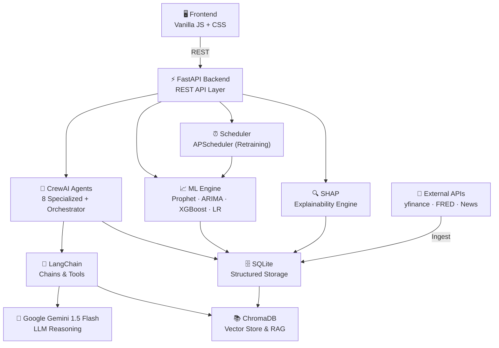

# FinIntel — Agentic AI Financial Intelligence Platform

<div align="center">


**Enterprise-grade Agentic AI platform for financial intelligence, predictive analytics, scenario modeling, and strategic recommendations.**

</div>

---

## 📋 Table of Contents

- [Overview](#overview)
- [Architecture](#architecture)
- [Tech Stack](#tech-stack)
- [Features & Functional Requirements](#features--functional-requirements)
- [Project Structure](#project-structure)
- [Installation & Setup](#installation--setup)
- [Environment Variables](#environment-variables)
- [Running the Application](#running-the-application)
- [API Reference](#api-reference)
- [Database Schema](#database-schema)
- [Frontend Navigation](#frontend-navigation)
- [AI & ML Models](#ai--ml-models)
- [Contributing](#contributing)

---

## 🌐 Overview

**FinIntel** is a full-stack, production-ready AI financial intelligence platform that combines:

- **Multi-Agent Orchestration** (CrewAI) for autonomous financial analysis workflows
- **Retrieval-Augmented Generation** (LangChain + ChromaDB) for grounded, evidence-backed insights
- **ML Forecasting** (Prophet, ARIMA, XGBoost, Linear Regression) for multi-horizon predictions
- **Explainable AI** (SHAP) for transparent, traceable decision support
- **What-If Scenario Engine** for macro-economic shock simulations
- **Strategic Recommendation System** with priority ranking and LLM justification

The platform ingests 5 years of historical financial data, monitors live market conditions, and delivers actionable intelligence through a clean web interface and RESTful API.

---

## 🏗️ Architecture



---

## 🛠️ Tech Stack

| Layer | Technology | Purpose |
|-------|-----------|---------|
| **Frontend** | Vanilla JavaScript, HTML5, CSS3 | Single-page web UI |
| **Backend** | Python 3.12, FastAPI, Uvicorn | REST API server |
| **ORM / DB** | SQLAlchemy, SQLite | Structured data storage |
| **Vector Store** | ChromaDB | Semantic document retrieval (RAG) |
| **LLM** | Google Gemini 1.5 Flash | Narrative generation & reasoning |
| **LLM Framework** | LangChain 0.3 | Chains, tools, agents, RAG |
| **Multi-Agent** | CrewAI | Autonomous agent orchestration |
| **Forecasting** | Prophet, statsmodels (ARIMA/SARIMA), scikit-learn | Time-series prediction |
| **Gradient Boosting** | XGBoost / GradientBoostingRegressor | Ensemble ML forecasting |
| **Explainability** | SHAP 0.51 | Feature importance & attribution |
| **Data Ingestion** | yfinance, pandas | Historical financial data |
| **Scheduling** | APScheduler | Periodic model retraining |
| **Config** | python-dotenv | Environment management |

---

## ✅ Features & Functional Requirements

### 2.1 Data Management (FR-001–004)
| FR | Requirement | Implementation |
|----|-------------|----------------|
| FR-001 | Ingest 5-year historical financial data | `data_service.py` → `yfinance` pull → `HistoricalData` table |
| FR-002 | Support document upload & parsing | `document_service.py` → PDF/text → `UnstructuredDocument` |
| FR-003 | Store financial metrics with timestamps | `FinancialMetric` model, SQLAlchemy ORM |
| FR-004 | Auto-monitor data freshness | APScheduler refresh job in `scheduler_service.py` |

### 2.2 Market Intelligence (FR-005–009)
| FR | Requirement | Implementation |
|----|-------------|----------------|
| FR-005 | Track economic indicators | `EconomicIndicator` model (GDP, CPI, rate, etc.) |
| FR-006 | Monitor geopolitical events | `GeopoliticalEvent` table |
| FR-007 | Classify event financial impact | LangChain impact classifier chain |
| FR-008 | Real-time news sentiment | News ingestion → `sentiment_score` field |
| FR-009 | Country/sector risk scoring | `market_intelligence_service.py` |

### 2.3 Knowledge Base & RAG (FR-010–014)
| FR | Requirement | Implementation |
|----|-------------|----------------|
| FR-010 | Build vector knowledge base | ChromaDB collection per document type |
| FR-011 | Semantic document search | `chroma_service.py` → cosine similarity |
| FR-012 | Retrieval-augmented generation | LangChain `RetrievalQA` + Gemini |
| FR-013 | Source citation & traceability | `UnstructuredDocument.file_name` + SHA-256 hash |
| FR-014 | Context grounding for recommendations | RAG context injected into all LLM prompts |

### 2.4 Multi-Agent System (FR-015–023)
| FR | Requirement | Implementation |
|----|-------------|----------------|
| FR-015 | Multi-agent orchestration | CrewAI `Crew` with 8 specialized agents |
| FR-016 | Data Analyst Agent | Fetches & preprocesses financial data |
| FR-017 | Market Intelligence Agent | Monitors indicators & events |
| FR-018 | Risk Assessment Agent | Evaluates portfolio & macro risk |
| FR-019 | Recommendation Agent | Generates strategic guidance |
| FR-020 | Forecasting Agent | Runs ML models & returns predictions |
| FR-021 | Scenario Agent | Executes what-if simulations |
| FR-022 | Explainability Agent | Generates SHAP reports |
| FR-023 | Orchestrator Agent | Coordinates all agents end-to-end |

### 2.5 Risk Assessment (FR-024–027)
| FR | Requirement | Implementation |
|----|-------------|----------------|
| FR-024 | Portfolio risk scoring | `risk_service.py` → composite risk index |
| FR-025 | Volatility & VaR calculation | Rolling stddev + historical VaR |
| FR-026 | Sector concentration risk | `SectorExposure` model |
| FR-027 | Real-time risk alerts | Threshold rules → `RiskAlert` table |

### 2.6 Predictive Analytics (FR-028–033)
| FR | Requirement | Implementation |
|----|-------------|----------------|
| FR-028 | Predict future business performance | `prediction_engine.py` — full ML pipeline |
| FR-029 | Revenue, EBITDA, Profit, Cash Flow, Demand forecasts | 5 target types in `PredictionRun` |
| FR-030 | Quarterly / Annual / 3-Year / 5-Year horizons | `horizon` param: `quarterly`, `annual`, `three_year`, `five_year` |
| FR-031 | Multiple ML models | Prophet · ARIMA · XGBoost/GBR · Linear Regression |
| FR-032 | Automatic model comparison (best model selection) | RMSE/MAPE/R² computed; best model auto-selected |
| FR-033 | Periodic model retraining | APScheduler weekly job calls `retrain_all_models()` |

### 2.7 Scenario Analysis (FR-034–036)
| FR | Requirement | Implementation |
|----|-------------|----------------|
| FR-034 | What-if analysis engine | `scenario_analysis.py` — full shock simulation |
| FR-035 | 5 macro scenario types | Currency · Tariff · Interest Rate · Supply Chain · Market Downturn |
| FR-036 | Financial impact estimation | Quantitative shock → impact metrics → LangChain narrative |

### 2.8 Recommendation Generation (FR-037–040)
| FR | Requirement | Implementation |
|----|-------------|----------------|
| FR-037 | Strategic recommendation platform | `recommendation_service.py` — 6-pillar engine |
| FR-038 | 6 recommendation categories | Cost Optimization · Investment · Risk Mitigation · Market Expansion · Pricing · Capital Allocation |
| FR-039 | Priority ranking | `priority_score` (0–1) computed per recommendation |
| FR-040 | Justification for each recommendation | LangChain + Gemini generates detailed rationale |

### 2.9 Explainable AI (FR-041–044)
| FR | Requirement | Implementation |
|----|-------------|----------------|
| FR-041 | Explainability for predictions | `explainability_engine.py` — SHAP values per model |
| FR-042 | Key driver identification | Top-N feature importances ranked by SHAP magnitude |
| FR-043 | SHAP-based feature importance | `TreeExplainer` (GBR) / `LinearExplainer` (LR) with safe ndarray handling |
| FR-044 | Traceability to source documents | SHA-256 citation → `UnstructuredDocument` file & snippet |

---

## 📁 Project Structure

```
Finance-project/
├── backend/
│   ├── app/
│   │   ├── main.py                      # FastAPI app entry point
│   │   ├── database.py                  # SQLAlchemy engine + init_db()
│   │   ├── models/
│   │   │   ├── __init__.py              # Imports all ORM models
│   │   │   ├── financial_data.py        # HistoricalData, FinancialMetric
│   │   │   ├── market_intelligence.py   # EconomicIndicator, GeopoliticalEvent
│   │   │   ├── knowledge_base.py        # UnstructuredDocument, ChromaRecord
│   │   │   ├── risk.py                  # RiskAlert, SectorExposure
│   │   │   ├── predictions.py           # PredictionRun, ModelRegistry
│   │   │   ├── scenario.py              # ScenarioRun
│   │   │   ├── recommendations.py       # StrategicRecommendationReport
│   │   │   └── explainability.py        # ExplainabilityRun
│   │   ├── services/
│   │   │   ├── data_service.py          # yfinance ingestion
│   │   │   ├── market_intelligence_service.py
│   │   │   ├── chroma_service.py        # ChromaDB vector operations
│   │   │   ├── langchain_tools.py       # LangChain tools (FR-001–044)
│   │   │   ├── crew_service.py          # CrewAI multi-agent workflows
│   │   │   ├── risk_service.py          # Risk scoring & alerts
│   │   │   ├── prediction_engine.py     # ML forecasting (FR-028–033)
│   │   │   ├── scenario_analysis.py     # What-if engine (FR-034–036)
│   │   │   ├── recommendation_service.py# Strategic recs (FR-037–040)
│   │   │   ├── explainability_engine.py # SHAP engine (FR-041–044)
│   │   │   └── scheduler_service.py     # APScheduler periodic jobs
│   │   └── api/
│   │       ├── router.py                # All API route definitions
│   │       └── schemas.py               # Pydantic request/response models
│   ├── .env                             # Environment variables (not committed)
│   └── verify_fr028_to_fr044.py         # Verification script
├── frontend/
│   ├── index.html                       # Single-page app shell
│   ├── js/
│   │   └── app.js                       # All frontend logic
│   └── css/
│       └── style.css                    # Styling & layout
├── data/
│   ├── fintech.db                       # SQLite database
│   └── chroma_store/                    # ChromaDB persistent vector store
├── requirements.txt                     # Python dependencies
└── README.md                            # This file
```

---

## ⚙️ Installation & Setup

### Prerequisites

- Python 3.10+ (tested on 3.12)
- pip or uv package manager
- Google API Key (for Gemini LLM)

### 1. Clone the repository

```bash
git clone https://github.com/<your-username>/Finance-project.git
cd Finance-project
```

### 2. Create a virtual environment

```bash
python -m venv venv
# Windows
venv\Scripts\activate
# macOS / Linux
source venv/bin/activate
```

### 3. Install dependencies

```bash
pip install -r requirements.txt
```

> **Note:** `shap`, `prophet`, and `xgboost` are heavy packages. Install may take 2–5 minutes.

---

## 🔐 Environment Variables

Create a file at `backend/.env`:

```env
# Google Gemini LLM (required for AI narratives & recommendations)
GOOGLE_API_KEY=your_google_api_key_here

# Optional: Override database path
DATABASE_URL=sqlite:///./data/fintech.db

# Optional: ChromaDB path
CHROMA_PERSIST_DIR=./data/chroma_store
```

> Get your free Gemini API key at [https://aistudio.google.com/app/apikey](https://aistudio.google.com/app/apikey)

---

## 🚀 Running the Application

### Start the Backend API

```bash
cd Finance-project
python -m uvicorn backend.app.main:app --reload --host 0.0.0.0 --port 8000
```

The API will be available at: `http://localhost:8000`  
Interactive docs (Swagger UI): `http://localhost:8000/docs`  
ReDoc: `http://localhost:8000/redoc`

### Open the Frontend

Open `frontend/index.html` directly in your browser, or serve it:

```bash
cd frontend
python -m http.server 3000
# Then open http://localhost:3000
```

### Initialize the Database & Seed Data

On first run, the database is auto-initialized. To ingest sample data:

```bash
# Ingest 5-year historical data for a ticker
curl -X POST http://localhost:8000/api/data/ingest \
  -H "Content-Type: application/json" \
  -d '{"ticker": "AAPL", "years": 5}'
```

---

## 📡 API Reference

### Data Management
| Method | Endpoint | Description |
|--------|----------|-------------|
| `POST` | `/api/data/ingest` | Ingest historical financial data |
| `GET` | `/api/data/{ticker}` | Get stored financial data |
| `POST` | `/api/documents/upload` | Upload financial document |

### Market Intelligence
| Method | Endpoint | Description |
|--------|----------|-------------|
| `GET` | `/api/market/indicators` | List economic indicators |
| `GET` | `/api/market/events` | List geopolitical events |
| `POST` | `/api/market/analyze` | Run market analysis |

### Multi-Agent Analysis
| Method | Endpoint | Description |
|--------|----------|-------------|
| `POST` | `/api/agents/analyze` | Trigger full CrewAI analysis |
| `GET` | `/api/agents/status/{job_id}` | Check agent job status |

### Predictive Analytics (FR-028–033)
| Method | Endpoint | Description |
|--------|----------|-------------|
| `POST` | `/api/predictions/run` | Run ML forecast for a ticker |
| `GET` | `/api/predictions/{ticker}` | Get prediction history |
| `GET` | `/api/predictions/run/{run_id}` | Get specific prediction run details |
| `POST` | `/api/predictions/retrain/{ticker}` | Trigger model retraining (FR-033) |

**Example request — Run Prediction:**
```json
POST /api/predictions/run
{
  "ticker": "AAPL",
  "target_type": "revenue",
  "horizon": "annual",
  "models": ["prophet", "arima", "gradient_boosting", "linear"]
}
```

### Scenario Analysis (FR-034–036)
| Method | Endpoint | Description |
|--------|----------|-------------|
| `GET` | `/api/scenarios/types` | List available scenario types |
| `POST` | `/api/scenarios/run` | Run a what-if scenario simulation |
| `GET` | `/api/scenarios/{ticker}` | Get scenario history for ticker |
| `GET` | `/api/scenarios/run/{run_id}` | Get specific scenario results |

**Example request — Run Scenario:**
```json
POST /api/scenarios/run
{
  "ticker": "TSLA",
  "scenario_type": "currency_fluctuation",
  "parameters": {
    "currency_pair": "USD/EUR",
    "change_percent": -15.0
  }
}
```

**Supported scenario types:**
- `currency_fluctuation` — Exchange rate shock (USD ± %)
- `tariff_increase` — Import/export tariff shock (± %)
- `interest_rate_change` — Central bank rate shift (± basis points)
- `supply_chain_disruption` — Supply cost shock & delay modeling
- `market_downturn` — Broad market correction scenario

### Recommendation Generation (FR-037–040)
| Method | Endpoint | Description |
|--------|----------|-------------|
| `POST` | `/api/recommendations/generate` | Generate strategic recommendations |
| `GET` | `/api/recommendations/{ticker}` | List recommendation reports |
| `GET` | `/api/recommendations/report/{report_id}` | Get full report |
| `GET` | `/api/recommendations/latest/{ticker}` | Get latest recommendation |

**Recommendation categories (FR-038):**
- 💰 **Cost Optimization** — Operational efficiency, vendor renegotiation
- 📈 **Investment Prioritization** — CapEx allocation, ROI-ranked projects
- 🛡️ **Risk Mitigation** — Hedging, diversification, insurance
- 🌍 **Market Expansion** — New geography/segment targeting
- 🏷️ **Pricing Strategies** — Dynamic pricing, margin optimization
- 🏦 **Capital Allocation** — Debt/equity balance, buybacks, dividends

### Explainable AI (FR-041–044)
| Method | Endpoint | Description |
|--------|----------|-------------|
| `POST` | `/api/explainability/prediction` | SHAP explanation for a prediction (FR-041–043) |
| `POST` | `/api/explainability/recommendation` | Decision driver attribution for a recommendation |
| `GET` | `/api/explainability/traceability/{ticker}` | Source document traceability map (FR-044) |
| `GET` | `/api/explainability/history/{ticker}` | Explainability audit history |

---

## 🗄️ Database Schema

```
HistoricalData          — OHLCV price data (ticker, date, open, high, low, close, volume)
FinancialMetric         — Quarterly metrics (revenue, ebitda, net_income, cash_flow, eps)
EconomicIndicator       — Macro indicators (GDP, CPI, interest_rate, unemployment, current_value)
GeopoliticalEvent       — Events (title, region, impact_level, sentiment_score)
UnstructuredDocument    — Uploaded docs (file_name, content_snippet, chroma_id, file_hash)
RiskAlert               — Alerts (ticker, alert_type, severity, message)
PredictionRun           — Forecast runs (ticker, target_type, horizon, models_json, results_json, best_model)
ModelRegistry           — Trained model metadata (model_name, ticker, target_type, metrics_json, trained_at)
ScenarioRun             — Scenario simulations (ticker, scenario_type, parameters_json, impact_metrics_json, narrative_analysis)
StrategicRecommendationReport — Recommendations (ticker, recommendations_json, priority_ranked, generated_at)
ExplainabilityRun       — SHAP runs (ticker, target_type, shap_values_json, feature_importance_json, key_drivers_json, traceability_sources_json)
```

---

## 🖥️ Frontend Navigation

The single-page web application has a sidebar with the following tabs:

| Tab | Description | FR Coverage |
|-----|-------------|-------------|
| 📊 **Dashboard** | KPI summary cards, market overview | FR-003, FR-005 |
| 📁 **Data Management** | Upload documents, trigger data ingestion | FR-001–004 |
| 🌍 **Market Intelligence** | Economic indicators, geopolitical events | FR-005–009 |
| 🤖 **AI Analysis** | Multi-agent analysis workflow | FR-015–023 |
| ⚠️ **Risk Assessment** | Risk scores, alerts, VaR | FR-024–027 |
| 📈 **Predictions** | ML forecast runner, model comparison table, history | FR-028–033 |
| 🎭 **Scenario Analysis** | What-if simulator with dynamic parameter panels | FR-034–036 |
| 💡 **Recommendations** | Priority-ranked recommendations with filter pills | FR-037–040 |
| 🔍 **Explainable AI (SHAP)** | SHAP viewer, key drivers, traceability map | FR-041–044 |

---

## 🤖 AI & ML Models

### Forecasting Models (FR-031)

| Model | Library | Strengths | Use Case |
|-------|---------|-----------|----------|
| **Prophet** | `prophet` | Trend + seasonality, handles missing data | Revenue, Demand long-term |
| **ARIMA** | `statsmodels` | Classic time-series, interpretable | Short-horizon stable series |
| **Gradient Boosting** | `sklearn` / `xgboost` | Non-linear patterns, feature-rich | EBITDA, Profit |
| **Linear Regression** | `sklearn` | Fast baseline, fully SHAP-compatible | All metrics baseline |

### Model Selection (FR-032)

Models are automatically compared using:
- **RMSE** — Root Mean Square Error (lower is better)
- **MAPE** — Mean Absolute Percentage Error
- **R²** — Coefficient of determination (higher is better)

The best model is selected and stored in `ModelRegistry` for each `(ticker, target_type)` pair.

### Explainability (FR-041–043)

| Component | Detail |
|-----------|--------|
| **SHAP TreeExplainer** | Used for GradientBoostingRegressor models |
| **SHAP LinearExplainer** | Used for Linear Regression models |
| **Feature set** | Lag features (1–3 periods), rolling mean (3-period), trend index |
| **Key drivers** | Top-5 features by absolute SHAP value magnitude |
| **Traceability** | Each explanation links to source `UnstructuredDocument` by SHA-256 hash |

---

## 📦 Key Dependencies

```
fastapi==0.115.*
uvicorn
sqlalchemy
chromadb
langchain==0.3.*
langchain-google-genai
langchain-community
crewai
prophet
statsmodels
scikit-learn
shap==0.51.0
pandas
numpy
yfinance
apscheduler
python-dotenv
pydantic
```

> Full list in [`requirements.txt`](./requirements.txt)

---

## 🤝 Contributing

1. Fork the repository
2. Create a feature branch: `git checkout -b feature/your-feature`
3. Follow the FR numbering convention for new features
4. Submit a pull request with a description of which FRs are addressed

---

## 📄 License

MIT License — see [LICENSE](./LICENSE) for details.

---

<div align="center">

**FinIntel** — Built with ❤️ using LangChain · CrewAI · ChromaDB · Google Gemini · FastAPI

</div>
