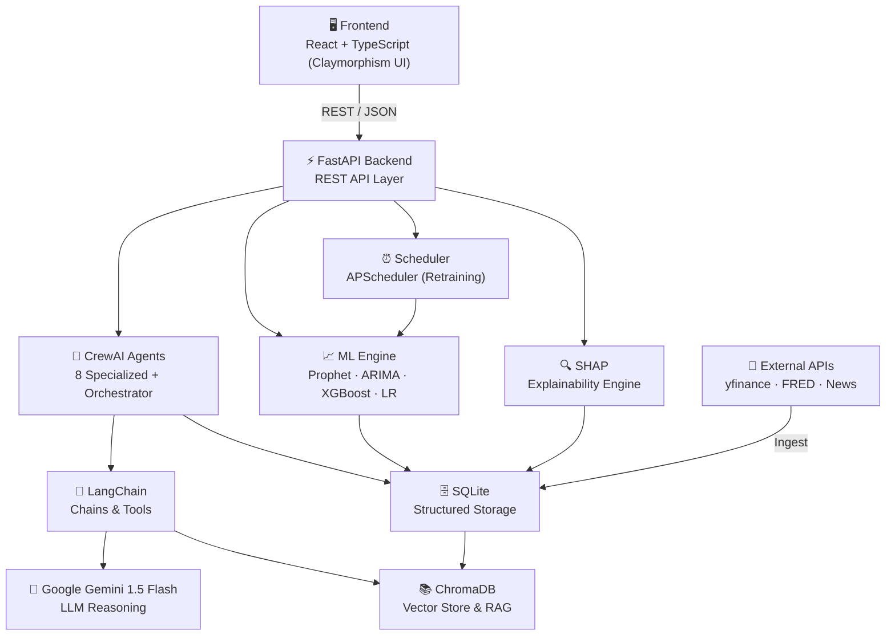

# FinIntel — Agentic AI Financial Intelligence Platform

<div align="center">


**Enterprise-grade Agentic AI platform for financial intelligence, predictive analytics, scenario modeling, and strategic recommendations.**

</div>

---

## 📋 Table of Contents

- [Overview](#overview)
- [Architecture](#architecture)
- [Tech Stack](#tech-stack)
- [Frontend (React + Claymorphism UI)](#frontend-react--claymorphism-ui)
- [Features & Functional Requirements](#features--functional-requirements)
- [Project Structure](#project-structure)
- [Installation & Setup](#installation--setup)
- [Environment Variables](#environment-variables)
- [Running the Application](#running-the-application)
- [API Reference](#api-reference)
- [Database Schema](#database-schema)
- [AI & ML Models](#ai--ml-models)
- [Contributing](#contributing)
- [License](#license)

---

## 🌐 Overview

**FinIntel** is a full-stack, enterprise-grade AI financial intelligence platform that combines:

- **Multi-Agent Orchestration** (CrewAI) for autonomous financial analysis workflows
- **Retrieval-Augmented Generation** (LangChain + ChromaDB) for grounded, evidence-backed insights
- **ML Forecasting** (Prophet, ARIMA, XGBoost, Linear Regression) for multi-horizon predictions
- **Explainable AI** (SHAP) for transparent, traceable decision support
- **What-If Scenario Engine** for macro-economic shock simulations
- **Strategic Recommendation System** with priority ranking (0–1.0) and LLM justification
- **Claymorphism React Frontend** for a tactile, soft-depth, modern user experience

The platform ingests 5 years of historical financial data, monitors live market conditions, and delivers actionable intelligence through a responsive web interface and RESTful API.

---

## 🏗️ Architecture



---

## 🛠️ Tech Stack

| Layer | Technology | Purpose |
|-------|------------|---------|
| **Frontend** | **React 19 + TypeScript + Vite + Tailwind CSS** | Component-based SPA styled in **Claymorphism** design |
| **Data Viz** | **Recharts + Lucide Icons** | Interactive time-series charts, area charts, and bar graphs |
| **Backend** | Python 3.12, FastAPI, Uvicorn | REST API & static asset delivery |
| **ORM / DB** | SQLAlchemy, SQLite | Structured data storage |
| **Vector Store** | ChromaDB | Semantic document retrieval (RAG) |
| **LLM** | Google Gemini 1.5 Flash | Narrative generation & reasoning |
| **LLM Framework** | LangChain 0.3 | Chains, tools, agents, RAG |
| **Multi-Agent** | CrewAI | Autonomous agent orchestration |
| **Forecasting** | Prophet, statsmodels (ARIMA/SARIMA), scikit-learn | Time-series prediction |
| **Gradient Boosting** | XGBoost / GradientBoostingRegressor | Ensemble ML forecasting |
| **Explainability** | SHAP 0.51 | Feature importance & attribution |
| **Data Ingestion** | yfinance, pandas | Historical financial data |
| **Scheduling** | APScheduler | Periodic model retraining |
| **Config** | python-dotenv | Environment management |

---

## 🎨 Frontend (React + Claymorphism UI)

The frontend has been completely rewritten in **React.js + TypeScript** using Vite and Tailwind CSS with a tactile **Claymorphism** aesthetic.

### Claymorphism Design Characteristics:
- **Soft 3D Pillowy Depth**: Diffuse outer drop shadows combined with subtle inner inset highlights (`clay-card`, `clay-card-inset`).
- **Tactile Inputs & Pill Buttons**: Bouncy interactive feedback on hover and press (`clay-btn-primary`, `clay-btn-secondary`, `clay-input`).
- **Smooth Color Palette**: Soft off-white clay background (`#eef2f7`), vibrant indigo/purple clay accents, and rounded corners (`rounded-2xl` to `rounded-3xl`).

### Available Tabs & Navigation:

| Tab | Component | FR Coverage | Description |
|-----|-----------|-------------|-------------|
| 📊 **Dashboard** | `DashboardTab.tsx` | Overview | KPI summary cards, financial growth chart, and decision launchpad |
| 📁 **Ingest Data** | `IngestTab.tsx` | FR-001 | Ingest 5-year OHLCV and volume market data into SQLite |
| 📄 **Documents** | `DocumentsTab.tsx` | FR-002 | Drag-and-drop document upload with SHA-256 integrity and Chroma chunking |
| 📈 **Financial Metrics** | `MetricsTab.tsx` | FR-003 | Quarterly and annual financial statement metrics (Revenue, EBITDA, FCF) |
| ⏰ **Auto-Monitoring** | `SchedulerTab.tsx` | FR-004 | APScheduler jobs status, manual freshness check, and audit logs |
| 🌍 **Market Intel** | `MarketIntelligenceTab.tsx` | FR-005–009 | Economic indicators, geopolitical events, sentiment, and sector risk matrix |
| 🧠 **Knowledge Base & RAG** | `RagTab.tsx` | FR-010–014 | Vector retrieval with ChromaDB and evidence-backed generative Q&A |
| 🤖 **Multi-Agent Hub** | `OrchestrationTab.tsx` | FR-015–023 | 8 CrewAI cooperative agents executing autonomous research workflows |
| 📉 **ML Predictions** | `PredictionsTab.tsx` | FR-028–033 | Prophet, ARIMA, XGBoost & Linear Regression forecasts with model selection |
| 🎭 **Scenario Analysis** | `ScenariosTab.tsx` | FR-034–036 | Macro shock simulations (Tariffs, Currency, Rates, Supply, Downturn) |
| 💡 **Recommendations** | `RecommendationsTab.tsx` | FR-037–040 | 6 Strategic pillars prioritized with Gemini LLM justifications |
| 🔍 **Explainable AI (SHAP)** | `ExplainabilityTab.tsx` | FR-041–044 | SHAP feature attribution bar chart, key drivers, and SHA-256 traceability |

---

## ✅ Features & Functional Requirements

### 2.1 Data Management (FR-001–004)
| FR | Requirement | Implementation |
|----|-------------|----------------|
| FR-001 | Ingest 5-year historical financial data | `data_service.py` → `yfinance` pull → `HistoricalData` table |
| FR-002 | Support document upload & parsing | `document_service.py` → PDF/text → `UnstructuredDocument` |
| FR-003 | Store financial metrics with timestamps | `FinancialMetric` model, SQLAlchemy ORM |
| FR-004 | Auto-monitor data freshness | APScheduler refresh job in `scheduler_service.py` |

### 2.2 Market Intelligence (FR-005–009)
| FR | Requirement | Implementation |
|----|-------------|----------------|
| FR-005 | Track economic indicators | `EconomicIndicator` model (GDP, CPI, rate, etc.) |
| FR-006 | Monitor geopolitical events | `GeopoliticalEvent` table |
| FR-007 | Classify event financial impact | LangChain impact classifier chain |
| FR-008 | Real-time news sentiment | News ingestion → `sentiment_score` field |
| FR-009 | Country/sector risk scoring | `market_intelligence_service.py` |

### 2.3 Knowledge Base & RAG (FR-010–014)
| FR | Requirement | Implementation |
|----|-------------|----------------|
| FR-010 | Build vector knowledge base | ChromaDB collection per document type |
| FR-011 | Semantic document search | `chroma_service.py` → cosine similarity |
| FR-012 | Retrieval-augmented generation | LangChain `RetrievalQA` + Gemini |
| FR-013 | Source citation & traceability | `UnstructuredDocument.file_name` + SHA-256 hash |
| FR-014 | Context grounding for recommendations | RAG context injected into all LLM prompts |

### 2.4 Multi-Agent System (FR-015–023)
| FR | Requirement | Implementation |
|----|-------------|----------------|
| FR-015 | Multi-agent orchestration | CrewAI `Crew` with 8 specialized agents |
| FR-016 | Data Analyst Agent | Fetches & preprocesses financial data |
| FR-017 | Market Intelligence Agent | Monitors indicators & events |
| FR-018 | Risk Assessment Agent | Evaluates portfolio & macro risk |
| FR-019 | Recommendation Agent | Generates strategic guidance |
| FR-020 | Forecasting Agent | Runs ML models & returns predictions |
| FR-021 | Scenario Agent | Executes what-if simulations |
| FR-022 | Explainability Agent | Generates SHAP reports |
| FR-023 | Orchestrator Agent | Coordinates all agents end-to-end |

### 2.5 Risk Assessment (FR-024–027)
| FR | Requirement | Implementation |
|----|-------------|----------------|
| FR-024 | Portfolio risk scoring | `risk_service.py` → composite risk index |
| FR-025 | Volatility & VaR calculation | Rolling stddev + historical VaR |
| FR-026 | Sector concentration risk | `SectorExposure` model |
| FR-027 | Real-time risk alerts | Threshold rules → `RiskAlert` table |

### 2.6 Predictive Analytics (FR-028–033)
| FR | Requirement | Implementation |
|----|-------------|----------------|
| FR-028 | Predict future business performance | `prediction_engine.py` — full ML pipeline |
| FR-029 | Revenue, EBITDA, Profit, Cash Flow, Demand forecasts | 5 target types in `PredictionRun` |
| FR-030 | Quarterly / Annual / 3-Year / 5-Year horizons | `horizon` param: `quarterly`, `annual`, `three_year`, `five_year` |
| FR-031 | Multiple ML models | Prophet · ARIMA · XGBoost/GBR · Linear Regression |
| FR-032 | Automatic model comparison (best model selection) | RMSE/MAPE/R² computed; best model auto-selected |
| FR-033 | Periodic model retraining | APScheduler weekly job calls `retrain_all_models()` |

### 2.7 Scenario Analysis (FR-034–036)
| FR | Requirement | Implementation |
|----|-------------|----------------|
| FR-034 | What-if analysis engine | `scenario_analysis.py` — full shock simulation |
| FR-035 | 5 macro scenario types | Currency · Tariff · Interest Rate · Supply Chain · Market Downturn |
| FR-036 | Financial impact estimation | Quantitative shock → impact metrics → LangChain narrative |

### 2.8 Recommendation Generation (FR-037–040)
| FR | Requirement | Implementation |
|----|-------------|----------------|
| FR-037 | Strategic recommendation platform | `recommendation_service.py` — 6-pillar engine |
| FR-038 | 6 recommendation categories | Cost Optimization · Investment · Risk Mitigation · Market Expansion · Pricing · Capital Allocation |
| FR-039 | Priority ranking | `priority_score` (0–1.0) computed per recommendation |
| FR-040 | Justification for each recommendation | LangChain + Gemini generates detailed rationale |

### 2.9 Explainable AI (FR-041–044)
| FR | Requirement | Implementation |
|----|-------------|----------------|
| FR-041 | Explainability for predictions | `explainability_engine.py` — SHAP values per model |
| FR-042 | Key driver identification | Top-N feature importances ranked by SHAP magnitude |
| FR-043 | SHAP-based feature importance | `TreeExplainer` (GBR) / `LinearExplainer` (LR) |
| FR-044 | Traceability to source documents | SHA-256 citation → `UnstructuredDocument` file & snippet |

---

## 📁 Project Structure

```text
Finance-project/
├── backend/
│   ├── app/
│   │   ├── main.py                      # FastAPI app entry point (serves React dist)
│   │   ├── database.py                  # SQLAlchemy engine + init_db()
│   │   ├── models/
│   │   │   ├── __init__.py              # Imports all ORM models
│   │   │   ├── financial_data.py        # HistoricalData, FinancialMetric
│   │   │   ├── market_intelligence.py   # EconomicIndicator, GeopoliticalEvent
│   │   │   ├── knowledge_base.py        # UnstructuredDocument, ChromaRecord
│   │   │   ├── risk.py                  # RiskAlert, SectorExposure
│   │   │   ├── predictions.py           # PredictionRun, ModelRegistry
│   │   │   ├── scenario.py              # ScenarioRun
│   │   │   ├── recommendations.py       # StrategicRecommendationReport
│   │   │   └── explainability.py        # ExplainabilityRun
│   │   ├── services/
│   │   │   ├── data_service.py          # yfinance ingestion
│   │   │   ├── market_intelligence_service.py
│   │   │   ├── chroma_service.py        # ChromaDB vector operations
│   │   │   ├── langchain_tools.py       # LangChain tools (FR-001–044)
│   │   │   ├── crew_service.py          # CrewAI multi-agent workflows
│   │   │   ├── risk_service.py          # Risk scoring & alerts
│   │   │   ├── prediction_engine.py     # ML forecasting (FR-028–033)
│   │   │   ├── scenario_analysis.py     # What-if engine (FR-034–036)
│   │   │   ├── recommendation_service.py# Strategic recs (FR-037–040)
│   │   │   ├── explainability_engine.py # SHAP engine (FR-041–044)
│   │   │   └── scheduler_service.py     # APScheduler periodic jobs
│   │   └── api/
│   │       ├── router.py                # All API route definitions
│   │       └── schemas.py               # Pydantic request/response models
│   ├── .env                             # Environment variables (not committed)
│   └── verify_fr028_to_fr044.py         # Verification script
├── frontend-react/                      # React 19 + TypeScript + Claymorphism UI
│   ├── public/                          # Static assets (favicons, icons)
│   ├── src/
│   │   ├── components/
│   │   │   ├── Sidebar.tsx              # Claymorphic navigation sidebar
│   │   │   ├── Header.tsx               # Active ticker & search bar
│   │   │   ├── DashboardTab.tsx         # Overview cards & charts
│   │   │   ├── IngestTab.tsx            # Historical data ingestion (FR-001)
│   │   │   ├── DocumentsTab.tsx         # Document upload & SHA-256 (FR-002)
│   │   │   ├── MetricsTab.tsx           # Quarterly/annual metrics (FR-003)
│   │   │   ├── SchedulerTab.tsx         # Auto-monitoring & retraining (FR-004)
│   │   │   ├── MarketIntelligenceTab.tsx# Macro indicators & sentiment (FR-005-009)
│   │   │   ├── RagTab.tsx               # ChromaDB retrieval & Q&A (FR-010-014)
│   │   │   ├── OrchestrationTab.tsx     # CrewAI multi-agent hub (FR-015-023)
│   │   │   ├── PredictionsTab.tsx       # ML forecasts (Prophet, XGBoost) (FR-028-033)
│   │   │   ├── ScenariosTab.tsx         # What-If shock engine (FR-034-036)
│   │   │   ├── RecommendationsTab.tsx   # 6 Strategic pillars (FR-037-040)
│   │   │   └── ExplainabilityTab.tsx    # SHAP feature attribution (FR-041-044)
│   │   ├── services/
│   │   │   └── api.ts                   # Axios API service client
│   │   ├── types.ts                     # TypeScript data interfaces
│   │   ├── App.tsx                      # Root application component
│   │   ├── index.css                    # Claymorphic design system styles
│   │   └── main.tsx                     # React DOM entry point
│   ├── dist/                            # Production build output
│   ├── package.json
│   ├── tsconfig.app.json
│   └── vite.config.ts
├── data/
│   ├── fintech.db                       # SQLite database
│   └── chroma_store/                    # ChromaDB persistent vector store
├── requirements.txt                     # Python dependencies
└── README.md                            # Complete documentation
```

---

## ⚙️ Installation & Setup

### Prerequisites

- Python 3.10+ (tested on 3.12)
- Node.js 18+ & npm
- Google Gemini API Key

### 1. Clone the repository

```bash
git clone https://github.com/<your-username>/Finance-project.git
cd Finance-project
```

### 2. Backend setup

```bash
python -m venv venv
# Windows
venv\Scripts\activate
# macOS / Linux
source venv/bin/activate

pip install -r requirements.txt
```

### 3. Frontend setup & build

```bash
cd frontend-react
npm install
npm run build
cd ..
```

---

## 🔐 Environment Variables

Create `backend/.env`:

```env
# Google Gemini LLM (required for AI narratives & recommendations)
GOOGLE_API_KEY=your_google_api_key_here

# Optional: Override database path
DATABASE_URL=sqlite:///./data/fintech.db

# Optional: ChromaDB path
CHROMA_PERSIST_DIR=./data/chroma_store
```

---

## 🚀 Running the Application

### Option A: Serve Full-Stack via FastAPI (Recommended)

When `frontend-react/dist` is built, FastAPI automatically serves the React Claymorphism application at the root URL:

```bash
python -m uvicorn backend.app.main:app --reload --host 0.0.0.0 --port 8000
```

- **Web Application**: `http://localhost:8000`
- **Interactive Swagger Docs**: `http://localhost:8000/docs`
- **ReDoc**: `http://localhost:8000/redoc`

### Option B: Standalone Frontend Dev Server (HMR)

```bash
cd frontend-react
npm run dev
```

Runs the Vite dev server at `http://localhost:5173` with instant Hot Module Replacement (HMR).

---

## 📡 API Reference

### Data Management
| Method | Endpoint | Description |
|--------|----------|-------------|
| `POST` | `/api/companies/ingest-historical` | Ingest historical financial data (FR-001) |
| `GET`  | `/api/companies` | List all tracked companies |
| `POST` | `/api/documents/upload` | Upload document with SHA-256 integrity (FR-002) |
| `GET`  | `/api/documents` | List indexed documents |
| `GET`  | `/api/metrics/{ticker}` | Get financial statement metrics (FR-003) |
| `GET`  | `/api/scheduler/status` | Check auto-monitoring engine status (FR-004) |

### Market Intelligence & RAG
| Method | Endpoint | Description |
|--------|----------|-------------|
| `GET`  | `/api/market-intelligence/indicators` | List macro economic indicators (FR-005) |
| `GET`  | `/api/market-intelligence/events` | List geopolitical events & sentiment (FR-006, 008) |
| `GET`  | `/api/market-intelligence/impact-matrix` | Country & sector risk scoring (FR-009) |
| `POST` | `/api/rag/search` | ChromaDB semantic document search (FR-011) |
| `POST` | `/api/rag/recommend` | Grounded generative recommendations (FR-012, 014) |

### Predictive Analytics (FR-028–033)
| Method | Endpoint | Description |
|--------|----------|-------------|
| `POST` | `/api/predictions/run` | Run multi-model forecast for a ticker |
| `GET`  | `/api/predictions/{ticker}` | Get prediction history |
| `POST` | `/api/predictions/retrain/{ticker}` | Trigger periodic model retraining (FR-033) |

### Scenario Analysis (FR-034–036)
| Method | Endpoint | Description |
|--------|----------|-------------|
| `GET`  | `/api/scenarios/types` | List available scenario types |
| `POST` | `/api/scenarios/run` | Run what-if shock simulation |
| `GET`  | `/api/scenarios/{ticker}` | Get scenario history |

### Strategic Recommendations (FR-037–040)
| Method | Endpoint | Description |
|--------|----------|-------------|
| `POST` | `/api/recommendations/generate` | Generate 6-pillar strategic guidance |
| `GET`  | `/api/recommendations/{ticker}` | List recommendation reports |

### Explainable AI (FR-041–044)
| Method | Endpoint | Description |
|--------|----------|-------------|
| `POST` | `/api/explainability/prediction` | SHAP feature attribution (FR-041, 043) |
| `POST` | `/api/explainability/recommendation` | Decision driver attribution (FR-042) |
| `GET`  | `/api/explainability/traceability/{ticker}` | Source document traceability map (FR-044) |

---

## 🤖 AI & ML Models

### Forecasting Models (FR-031)

| Model | Library | Strengths | Use Case |
|-------|---------|-----------|----------|
| **Prophet** | `prophet` | Trend + seasonality decomposition | Long-term Revenue & Demand |
| **ARIMA** | `statsmodels` | Classical stationary time-series | Short-horizon stable metrics |
| **Gradient Boosting** | `xgboost` / `sklearn` | Non-linear interaction handling | High-variance EBITDA & Net Income |
| **Linear Regression** | `sklearn` | Transparent linear baseline | Benchmark & SHAP Linear baseline |

### Automatic Model Comparison (FR-032)

Each forecast automatically computes:
- **RMSE** (Root Mean Square Error)
- **MAPE** (Mean Absolute Percentage Error)
- **R² Score** (Coefficient of determination)

The best model is dynamically selected and tagged in the `ModelRegistry`.

---

## 🤝 Contributing

1. Fork the repository
2. Create your feature branch (`git checkout -b feature/amazing-feature`)
3. Follow the FR numbering convention for any new features
4. Submit a pull request with details on test verification

---

## 📄 License

MIT License — see [LICENSE](./LICENSE) for details.

---

<div align="center">

**FinIntel** — Built with React · Tailwind CSS · FastAPI · CrewAI · ChromaDB · Google Gemini

</div>
